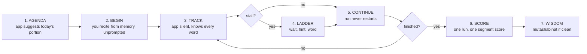
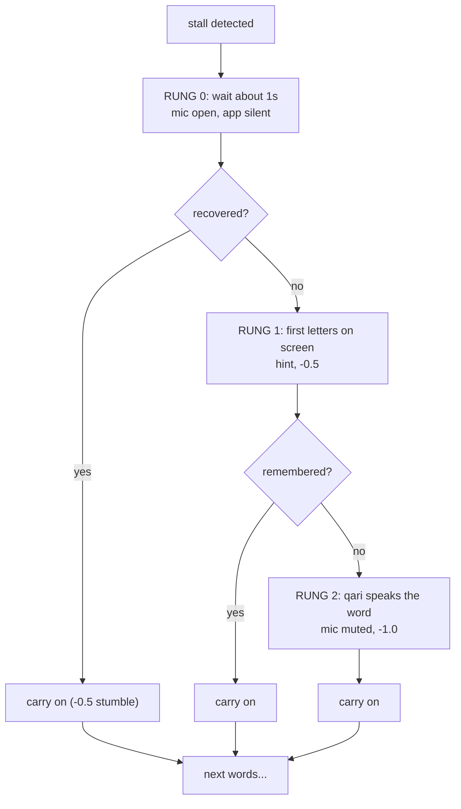
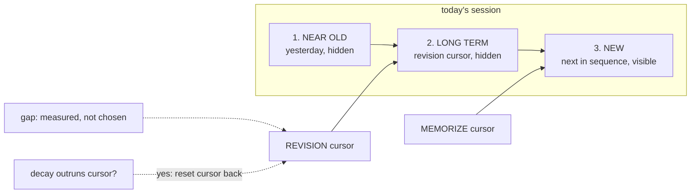

# nour — product map (visual)

The session model from `PLAN.md` §2b, drawn instead of described. If text and
picture disagree, the text in `PLAN.md` wins — update both.

## 1. The session loop

## 2. The prompt ladder

## 3. The three segments and the two cursors

## Reading guide

- Diagram 1 is the whole product. Everything else is detail.
- Diagram 2 is the only intelligent interaction. One tunable: the wait duration.
- Diagram 3 is the scheduler. Mechanical order, one measured gap, one override.
